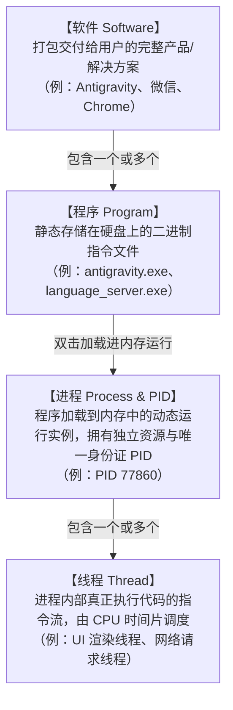
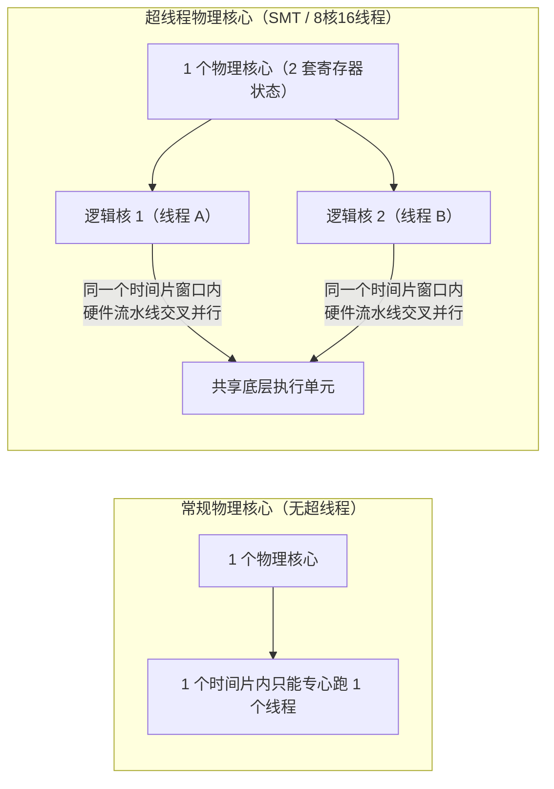
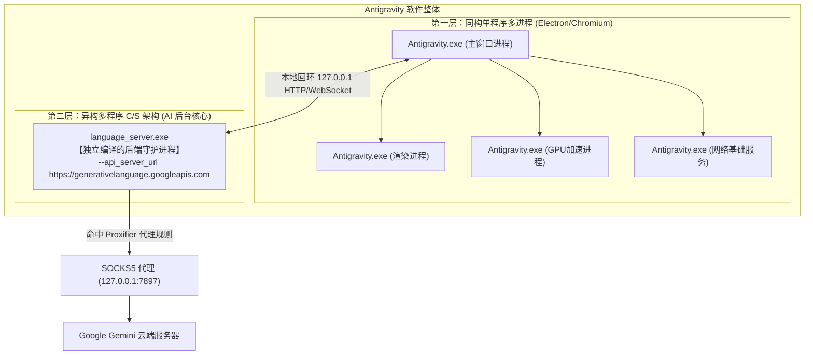

# 操作系统与现代软件架构核心：软件、程序、进程(PID)、线程与 CPU 调度

> **导读**：本文以 Proxifier 代理分流中“为什么 Antigravity 界面直连却依然能调用 AI”的现象为引子，层层拆解操作系统中**软件、程序、进程（PID）、线程（Thread）**的层级模型，并深入到底层硬件剖析 **CPU 核心、超线程（Hyper-Threading）与时间片（Time Slice）** 的调度机制。

---

## 一、宏观到微观：四大概念的完整统一模型

在计算机系统中，“软件、程序、进程、线程”并不是同义词，而是处于完全不同的系统抽象层级：

### 1. 软件（Software）—— 宏观商业产品
* **定义**：交付给用户的一整套完整产品或解决方案。
* **特点**：它是资源的集合体，不仅包含可执行文件，还包含配置文件、依赖库（DLL）、静态资源、图标、甚至多个后台辅助服务。
* **比喻**：相当于一家对外营业的**“综合餐厅”**。

### 2. 程序（Program）—— 静态硬盘文件
* **定义**：静态保存在硬盘上的二进制可执行文件（如 `.exe`、`.dll`）。
* **特点**：死物，不运行时仅占用硬盘空间，不消耗 CPU 和内存。
* **比喻**：厨房里的**“标准菜谱”**或剧场的**“剧本”**。

### 3. 进程（Process）与 PID —— 动态内存实例与资源容器
* **定义**：操作系统将程序代码加载进内存后，正在运行的**动态实例（Instance）**。
* **特点**：
  * **资源分配的最小单位**：操作系统以进程为边界分配独立的虚拟地址空间、文件句柄（Handle）、网络端口和安全权限。
  * **进程隔离**：不同进程之间的内存是物理/逻辑隔离的，彼此不能随意访问，保障了系统的稳定性与安全性。
  * **PID（Process Identifier）**：操作系统的唯一身份证号，用于跟踪和管理每一个运行实例。
  * **一程序生多进程**：同一个静态程序文件（如 `Antigravity.exe`），可以被多次加载或自我派生出多个独立进程（不同的 PID）。
* **比喻**：根据菜谱支起的一间**独立厨房（办公室）**，拥有独立水电气表（句柄/资源）和营业牌照（PID）。

### 4. 线程（Thread）—— 最小 CPU 执行单元
* **定义**：进程内部具体执行代码指令的路径，是 **CPU 调度的基本单位**。
* **英文**：`Thread`（原意为“线 / 线索”，表示代码指令如同一根细线按序执行）。
* **特点**：
  * **轻量级**：线程自身只占用极小的调用栈（Stack）和程序计数器（PC），不独立占有大块系统资源。
  * **共享进程资产**：同一个进程内的所有线程，共享该进程的全部虚拟内存、全局变量和文件句柄。
  * **协同工作**：主线程负责 UI 响应，子线程负责后台网络传输与文件下载，避免界面因耗时操作出现“未响应”。
* **比喻**：厨房里具体干活的**厨师（员工）**。大厨掌勺（主线程），配菜工洗菜（后台线程），共享厨房全部食材。

---

## 二、关键认知避坑：线程组合起来就是进程吗？

> **核心结论：绝对不是！“组合”这个词会产生严重误解。**

很多初学者容易误以为“一堆线程拼在一起就是进程”（类似积木拼成房子）。

实际上：
* **进程是【容器与空间】**（办公室）；
* **线程是【容器里的执行者】**（员工）。

1. 哪怕办公室里**只有 1 名员工**（单线程程序），它依然占着一整间独立办公室、享有完整独立内存（是一个完整的进程）。
2. 办公室（进程）提供场地和资源，员工（线程）提供劳动力（消耗 CPU 算力）。二者是**“容器与内容物”**的关系，而不是单纯的“零件组合”。

---

## 三、硬件深潜：CPU 核心、超线程与时间片

CPU 是如何面对成千上万个线程工作的？

### 1. CPU 的核到底在处理什么？
> **CPU 的每一个核心（Core），独立处理的是【线程（Thread）】，绝对不是进程。**

在硬件核心眼里，没有“微信”或“Antigravity”这些软件/进程的概念，只有一串串由操作系统喂过来的、嗷嗷待哺的**机器指令流（线程）**。

### 2. 常规核心 vs 超线程核心（Hyper-Threading / SMT）
购买电脑常看到的“8 核 16 线程”，其物理本质如下：

* **常规物理核心**：内部只有 1 套运算器和 1 套寄存器。在任意给定的时间片里，**只能处理 1 个线程**。
* **超线程核心（Hyper-Threading）**：物理核心内部集成了 **2 套架构状态（寄存器组）**。操作系统将其识别为 **2 个逻辑核**，在一个时间片窗口内，可以**硬件级交替填充流水线，同时推进 2 个线程**。

### 3. 时间片（Time Slice）与并发假象
如果系统中有 4000+ 个线程，而 CPU 只有 16 个逻辑核心，如何运行？

* **时间片轮转（Time Slicing）**：操作系统调度器将 CPU 运行时间切分成以毫秒（约 10~30ms）为单位的极细小“时间片”。
* **上下文切换（Context Switch）**：给线程 A 分配 15ms，时间一到立即吹哨换人，保存线程 A 的进度，拉上排队的线程 B。
* 因为每秒切换成千上万次，快于人类感知极限，宏观上呈现出“所有应用都在丝滑并行”的假象。

---

## 四、实战剖析：Antigravity 的多进程解耦架构

为什么在 Proxifier 中将 `antigravity.exe` 设置为直连（Direct），软件依然能正常与 Google Gemini 大模型通信？

### 1. 软件的“解耦”（Decoupling）
* **英文**：`Decoupling`（松耦合：`Loose Coupling`）。
* **含义**：将系统中的各个功能模块解开绑定，通过标准协议（网络通信、IPC）交互，互不拖累。
* **好处**：AI 计算即便崩溃，编辑器主界面毫发无损，可以在后台毫秒级重启恢复，保障极高稳定性。

### 2. Antigravity 的双层架构模型

### 3. Proxifier 规则命中真相
在用户的 Proxifier 配置中：
1. **第 1 条规则**：`antigravity.exe` $\rightarrow$ `Direct`（直连）。
   * 仅放行了前端 UI 窗口，让 Chromium 使用系统原生网络栈，避免底层 Hook 冲突。
2. **第 3 条规则**：`localhost; 127.0.0.1` $\rightarrow$ `Direct`（直连）。
   * 前端 UI 与后台 `language_server.exe` 通过本地端口高速通信。
3. **第 4 条规则**：`language_server.exe; ...` $\rightarrow$ `Proxy SOCKS5`。
   * **真正发起大模型 API 请求的不是 UI，而是独立的 `language_server.exe`！**
   * 它未命中第 1 条规则，精确命中第 4 条规则走代理顺利出海。

---

## 五、知识拓展：VS Code 与 Visual Studio 的真正关系

很多人误以为 VS Code 是 Visual Studio 的一部分，实际上是彻底不同的两个产品：

| 对比维度 | Visual Studio (VS) | Visual Studio Code (VS Code) |
| :--- | :--- | :--- |
| **软件定位** | 重量级大型 IDE（集成开发环境） | 轻量级代码编辑器（Editor） |
| **安装体积** | 20 GB ~ 50 GB | 80 MB ~ 200 MB |
| **跨平台性** | 主要是 Windows 原生 | 跨平台（Windows / macOS / Linux / Web） |
| **底座架构** | C++ / C# / .NET 原生内核 | **Electron + TypeScript + LSP 协议** |
| **开源状态** | 闭源商业产品 | **核心开源（Code - OSS）** |

*包括 Antigravity、Cursor、Windsurf 等新一代 AI 编辑器，均是以微软开源的 **VS Code (Code - OSS)** 作为前端 UI 底座，二次开发集成各自的独立后台 AI 引擎构建而成。*

---

## 六、总结记忆卡

* **软件 (Software)**：你买的整辆车。
* **程序 (Program)**：车里的发动机图纸或独立零件（`.exe`）。
* **进程 (Process / PID)**：真正发动起来、占着车道的一台台独立引擎（资源分配单位）。
* **线程 (Thread)**：引擎内部高速运转的活塞（CPU 调度的最小单位）。
* **CPU 核心 (Core)**：提供物理算力的气缸，常规每缸做一路工（1 线程），超线程技术能让一缸压两路工（2 线程）。
* **时间片 (Time Slice)**：交警秒级调度的红绿灯，让数千线程轮流使用有限的核心。
